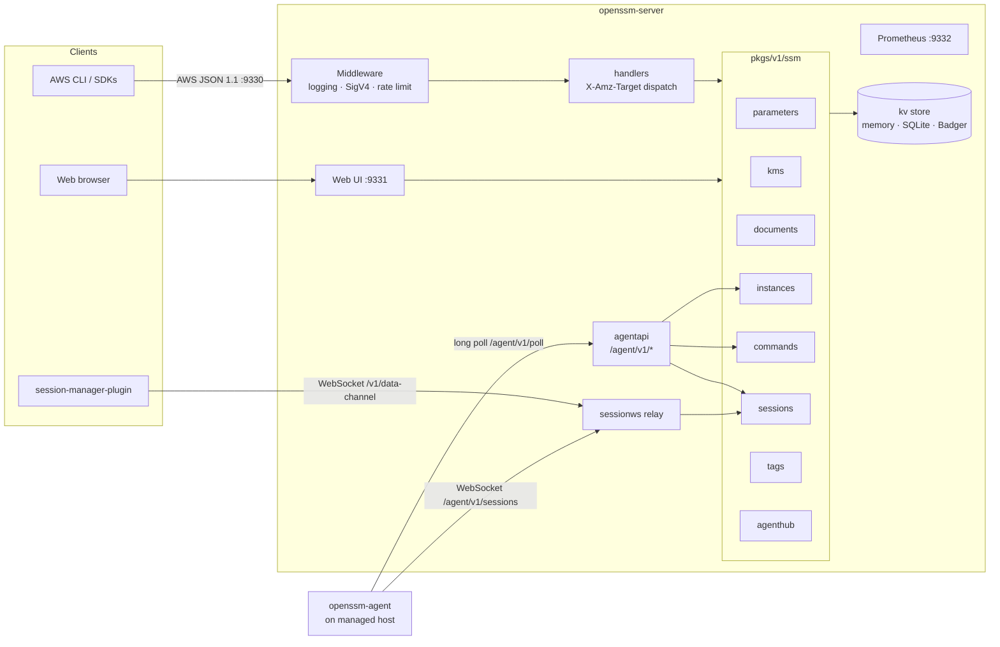
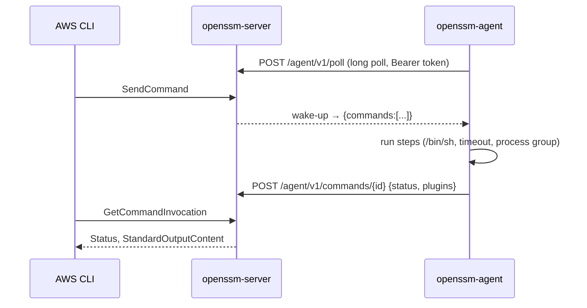
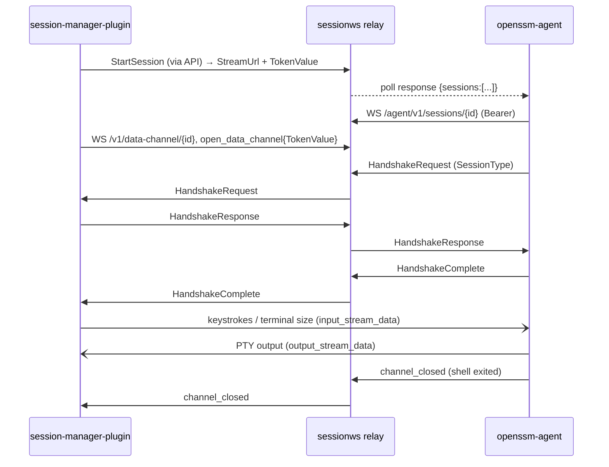

# Architecture

OpenSSM is a single Go server (`openssm-server`) plus an optional host agent (`openssm-agent`).
The server exposes the AWS SSM API and everything needed by agents and Session Manager clients on one port.

## Components

| Component | Location | Responsibility |
|-----------|----------|----------------|
| Entry point | `apps/go/server/main.go` | Load config, open storage, build services, start servers, graceful shutdown, maintenance loop |
| Storage | `apps/go/server/storage.go`, `pkgs/v1/kv` | One transactional kv store per process; credentials share the same database |
| Middleware | `apps/go/server/middleware` | Request logging, SigV4 auth (`ssm` service), global or per-action rate limiting |
| Protocol | `apps/go/server/protocol` | AWS JSON 1.1 request decoding and `{"__type","message"}` errors |
| Handlers | `apps/go/server/handlers` | Typed action registry: `register(h, "PutParameter", svc.Put)` |
| Agent API | `apps/go/server/agentapi` | Agent registration, heartbeats, long polling, command results |
| Session relay | `apps/go/server/sessionws` | Bridges plugin and agent data channels per session |
| UI | `apps/go/server/ui` | Server-rendered pages for every domain plus credentials and metrics |
| Domain services | `pkgs/v1/ssm/*` | Business logic, validation, AWS-compatible shapes and errors |
| Agent | `apps/go/agent`, `pkgs/v1/agent` | Host agent: registration, executor, PTY sessions |

## Request flow (SSM API)

1. `POST /` with `X-Amz-Target: AmazonSSM.<Action>` and a JSON body.
2. Middleware chain: request logger → SigV4 auth (verifies the signature and puts the caller identity in the
   context) → rate limiter.
3. `handlers.Handler` looks up the action, decodes the body into the service's input struct, calls the service,
   and marshals the output. Errors are converted with `types.AsSSMError`; unknown errors become
   `InternalServerError` (HTTP 500).
4. Services run inside `kv.Store` transactions. Writes are atomic: either a whole `PutParameter` (new version,
   tags, encryption) commits or nothing does.

## Domain services

- **kms** — Each key holds random 256-bit material wrapped with a master key derived from `kms.masterKey`
  (defaults to `ssm.serverSecret`). SecureString values are sealed with AES-256-GCM, bound to the parameter
  name as additional authenticated data. `alias/aws/ssm` is created on first start.
- **parameters** — Stores every retained version (max 100) of a parameter in one record. Labels move between
  versions; `name:version` and `name:label` selectors are supported. Expiration policies are enforced lazily on
  read and by the maintenance sweep.
- **documents** — Versioned content with a default version. Built-in Amazon documents are re-seeded at
  startup. `Resolve` returns parsed content for execution; `ResolveParameters` and `Interpolate` render
  `{{ parameter }}` references.
- **instances** — Activations (hashed codes, registration limits, expiry), managed instances (`mi-` + 17 hex),
  per-instance bearer tokens (hashed at rest), ping status from heartbeats, tag-based target resolution.
- **commands** — `SendCommand` validates the document and parameters, renders steps, and writes one invocation per
  target plus a per-instance delivery queue entry. The agent claims queued work, executes it, and reports
  results. A sweep times out undelivered invocations (`TimeoutSeconds`) and lost executions.
- **sessions** — `StartSession` checks the target is Online, stores a hashed one-time data channel token, and
  queues the session for the agent. `ResumeSession` rotates the token; `TerminateSession` notifies the relay.
- **tags** — Tags for every resource type, written inside the owning service's transaction.
- **agenthub** — In-memory wake-ups so a long-polling agent returns immediately when work is queued.

## Agent data path (Run Command)

Cancellation (`CancelCommand`) of a delivered invocation is returned to the agent in the next poll; the agent kills
the step's process group and reports `Cancelled`.

## Session data path

The relay is an endpoint on each side: it acknowledges, orders and retransmits stream data independently per
connection and forwards payloads. This lets the plugin reconnect with `ResumeSession` (sequence numbers carry
over) and keeps each hop simple. See [protocol.md](protocol.md#session-manager-data-channel).

## Storage

All persistent state lives in one kv store selected by `ssm.storageType`:

| Bucket | Owner | Key |
|--------|-------|-----|
| `parameters` | parameters | parameter name |
| `documents` | documents | document name |
| `kms_keys`, `kms_aliases` | kms | key ID / alias |
| `tags` | tags | `<ResourceType>\x00<id>` |
| `activations`, `instances` | instances | activation ID / instance ID |
| `commands`, `invocations`, `command_queue` | commands | command ID / `<command>\x00<instance>` / `<instance>\x00<command>` |
| `sessions`, `session_queue` | sessions | session ID / `<instance>\x00<session>` |

Credentials use their own table/prefix in the same database (`pkgs/v1/credentials`).

OpenSSM is designed to run as a **single replica**: state is local to the process (SQLite/Badger files or memory),
and the agent hub and session relays are in-memory.

## Background maintenance

Every 30 seconds the server deletes expired parameters, times out command invocations, fails sessions that never
connected, and refreshes resource gauges (`openssm_parameters`, `openssm_documents`, `openssm_managed_instances`).

## Security model

- SSM API requests are authenticated with SigV4 against credentials created in the UI or seeded from config.
  `/agent/*` and `/v1/data-channel/*` are exempt from SigV4 and use their own credentials.
- Agents authenticate with a per-instance bearer token obtained by redeeming an activation code. Tokens and
  activation codes are stored as SHA-256 hashes; deregistering an instance revokes its token.
- Data channel tokens are random, hashed at rest, and rotated by `ResumeSession`.
- SecureString plaintext is never stored. Changing the KMS master key makes existing values unreadable.
- The UI has no authentication of its own (like opensqs): expose it only on trusted networks.
